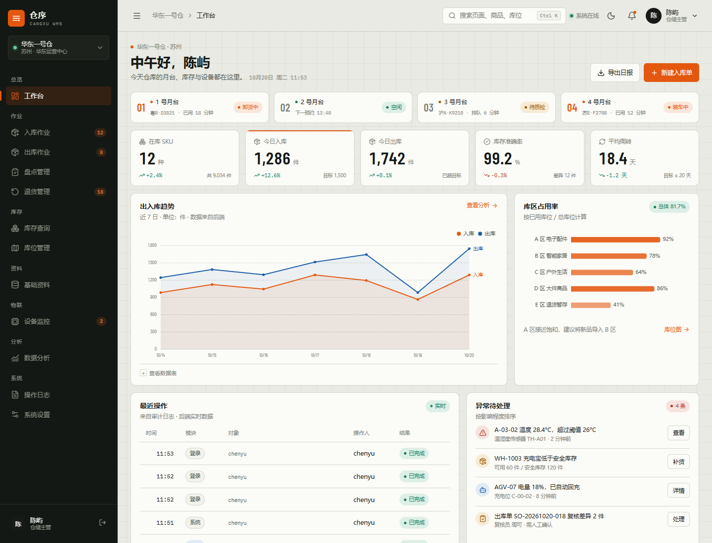
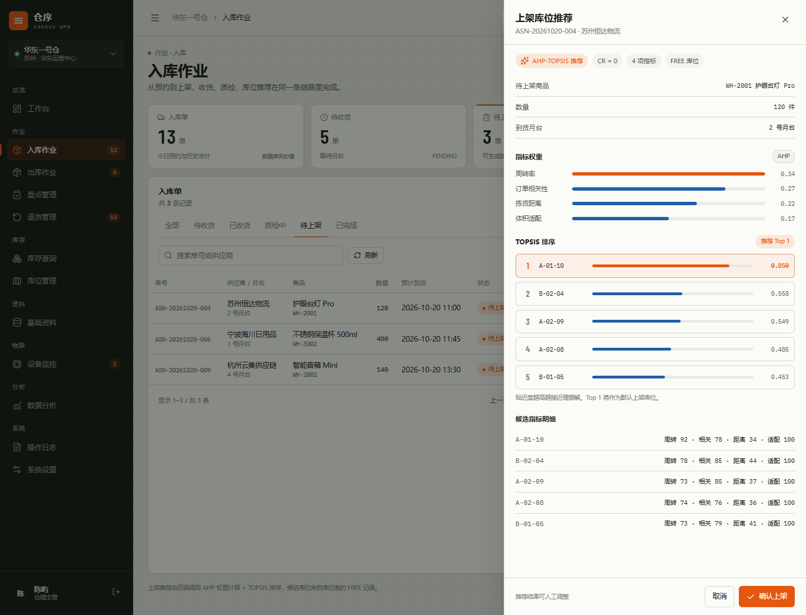
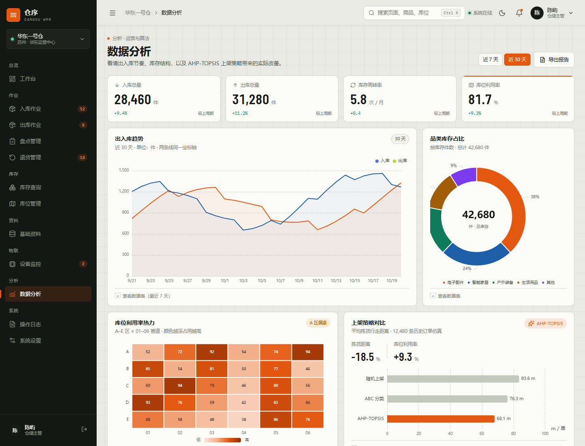

# 仓序 WMS · 智能仓储管理系统

> **在线演示（静态版）：** https://yueliangshuxia.github.io/cangxu-wms/  
> **GitHub 仓库：** https://github.com/yueliangshuxia/cangxu-wms  
> **演示账号：** `chenyu / wms2026`（主管）、`admin / admin123`（管理员）、`linzhou / wms2026`（收货员）、`zhouke / wms2026`（质检员）
>
> **最终选题：** 《基于 Spring Boot 与 Vue 的智能仓储管理系统设计与实现》
>
> 说明：工程型选题，AHP-TOPSIS 货位推荐作为系统核心模块；MQTT 设备接入作为“设备监控”模块实现，论文中写作“虚拟设备验证”，题目不承诺硬件。
>
> 技术栈：Spring Boot 4 + Java 21 + MyBatis-Plus + MySQL/H2 + Vue 3 + Vite + ECharts + MQTT（虚拟设备）
>
> 核心方法：Apriori 订单关联 + AHP 权重 + TOPSIS 货位排序

一个面向毕业设计的完整仓储管理系统：既有可点击的静态设计原型，也有真实可运行的前后端工程。核心亮点是把“上架货位怎么选”做成可解释、可实验的 AHP-TOPSIS 决策，并接进入库、出库、库存、库位、设备与审计的业务闭环。

## 当前进度

| 部分 | 状态 |
|---|---|
| 静态设计 Demo（根目录 HTML） | 已完成，14 个页面（含 404 与登录），作为视觉与交互基准 |
| Spring Boot 后端 | 已完成登录/JWT/权限、用户管理、主数据、库存、库位、入库（含上架推荐）、出库（含拣货路线）、盘点、退货、设备、设置、审计、CSV 导出、AHP/TOPSIS/Apriori |
| Vue 3 前端 | 12 个业务页面 + 登录；全部业务页面接真实 API，分析页读取实验输出 |
| 数据分析 | `experiments/run_experiment.py` 生成可复现对比实验；工作台/分析页使用真实聚合 |
| MQTT 虚拟设备 | Python 模拟器 + 后端订阅已完成端到端验证（amqtt broker） |
| 论文文档 | 选题、论文主线、实验报告、技术方案、设计确认清单、接口文档 |
| 待完善 | 生产部署配置未在本机 Docker 验证；实验数据为仿真数据 |

## Vue 全栈版预览







更多截图（登录、库存、库位、设备、审计、盘点、退货、设置）见 [`docs/screenshots/`](docs/screenshots/)。

## 快速开始

### 1. 启动后端

环境：Java 21+（项目自带 Maven Wrapper，不需要本机安装 Maven）。

```bash
cd backend
./mvnw spring-boot:run
```

默认使用 **H2 内存数据库 + dev profile**，不需要安装 MySQL；每次重启会重新加载 seed 数据。
健康检查：<http://localhost:8080/api/v1/health>

如果要使用 MySQL 8（本机已初始化并验证）：

```bash
# 换机器或重建数据库时，先以 root 身份初始化数据库和演示账号 wms/wms2026
mysql -u root -p < backend/database/mysql-init.sql

# 用 mysql profile 启动（默认连接 cangxu_wms，账号 wms/wms2026）
cd backend
./mvnw spring-boot:run -Dspring-boot.run.profiles=mysql
```

本机当前就是用 mysql profile 启动的；如果是第一次在别的机器上跑，再执行上面的初始化脚本。

初始化脚本会创建 `cangxu_wms` 数据库、`wms` 用户、全部表和 seed 数据。表和带唯一键的 seed 行可重复执行；`inventory`、`audit_log`、各类明细表没有唯一键，重复执行会追加行，建议首次初始化时运行一次。
如果不想用默认演示账号，设置 `DB_USERNAME` / `DB_PASSWORD` 环境变量覆盖，并同步修改
`backend/database/mysql-init.sql` 里的账号密码。

### 2. 启动前端

环境：Node 20+。

```bash
cd frontend
npm install
npm run dev
```

打开 <http://localhost:5173>，Vite 会把 `/api` 代理到 `http://localhost:8080`。

演示账号：

| 账号 | 密码 | 角色 |
|---|---|---|
| `chenyu` | `wms2026` | 仓储主管 |
| `admin` | `admin123` | 系统管理员 |
| `linzhou` | `wms2026` | 收货员 |
| `zhouke` | `wms2026` | 质检员 |

### 3. 可选：启动虚拟 IoT 模拟器

不需要任何硬件。模拟器通过 MQTT 发布温湿度、AGV 状态与 RFID 扫描事件。

```bash
cd simulator
pip install -r requirements.txt
python simulator.py --dry-run          # 先看消息格式
python simulator.py --host localhost --port 1883
```

让后端接收 MQTT：

```bash
cd backend
MQTT_ENABLED=true MQTT_BROKER_URL=tcp://localhost:1883 ./mvnw spring-boot:run
```

Broker 可用 Mosquitto/EMQX；没有 broker 时模拟器可用 `--dry-run`，后端保持 `MQTT_ENABLED=false` 也能正常运行。
详见 [`simulator/README.md`](simulator/README.md)。

## 页面与接口

| 页面 | 前端路由 | 数据来源 | 关键功能 |
|---|---|---|---|
| 登录 | `/login` | `POST /api/v1/auth/login` | JWT 登录、角色 |
| 工作台 | `/dashboard` | `GET /api/v1/dashboard/overview` | 月台、KPI、趋势、库区占用、审计动态 |
| 入库作业 | `/inbound` | `/api/v1/inbound/*` | 收货、质检、**AHP-TOPSIS 上架推荐**、确认上架 |
| 出库作业 | `/outbound` | `/api/v1/outbound/*` | 生成波次、拣货完成、发运 |
| 库存查询 | `/inventory` | `/api/v1/inventory` | 筛选、分页、库存详情 |
| 库位管理 | `/locations` | `/api/v1/locations` | 1F 库区图、锁定/释放 |
| 基础资料 | `/masterdata` | `/api/v1/products` 等 | 商品/供应商/客户 |
| 盘点管理 | `/stocktake` | `/api/v1/stocktakes/*` | 任务、开始、扫码计数、差异明细 |
| 退货管理 | `/returns` | `/api/v1/returns/*` | 退货列表、质检处置、状态回写 |
| 设备监控 | `/devices` | `/api/v1/devices/*` | 温湿度曲线、设备清单、AGV |
| 数据分析 | `/analytics` | 前端实验可视化 | 趋势、品类、热力、算法对比 |
| 操作日志 | `/audit` | `/api/v1/audit-logs` | 筛选、分页、日志详情 |
| 系统设置 | `/settings` | `/api/v1/settings`、`/api/v1/users` | 仓库信息、预警/通知开关持久化；用户与角色支持增删改查 |

后端 API 前缀：`/api/v1`。核心接口：

```text
POST /auth/login
GET  /dashboard/overview

GET  /products?page=&size=&keyword=&category=&status=
GET  /suppliers
GET  /customers

GET  /inventory
GET  /locations
PATCH /locations/{code}/status
GET  /inbound/orders
POST /inbound/orders
POST /inbound/orders/{id}/receive
POST /inbound/orders/{id}/inspect
GET  /inbound/orders/{id}/slot-recommendation
POST /inbound/orders/{id}/putaway
GET  /outbound/orders
POST /outbound/waves
POST /outbound/orders/{id}/pick
POST /outbound/orders/{id}/ship
GET  /devices
GET  /devices/{code}/telemetry?metric=temp&hours=24
GET  /audit-logs

GET  /stocktakes
POST /stocktakes
POST /stocktakes/{id}/start
POST /stocktakes/{id}/scan
GET  /stocktakes/diffs

GET  /returns
POST /returns/{id}/inspect

GET  /settings
PUT  /settings
```

## 核心方法：AHP-TOPSIS 上架推荐

1. **AHP**：4×4 判断矩阵 → 几何平均求权重 → 一致性检验。当前权重约为
   周转率 0.34、订单相关性 0.27、拣货距离 0.22、体积适配 0.17，CR = 0。
2. **TOPSIS**：对候选库位的四项指标做向量归一化、加权，计算与正/负理想解的距离，
   得到贴近度并降序排列。距离为成本型指标，其余为效益型指标。
3. **候选库位**：来自 `location` 表中 `FREE` 的记录；推荐结果由
   `GET /inbound/orders/{id}/slot-recommendation` 返回。
4. **业务闭环**：确认上架后写库位状态、库存和审计日志（`POST /inbound/orders/{id}/putaway`）。

代码位置：

```text
backend/src/main/java/com/cangxu/wms/algorithm/
├── AhpWeightCalculator.java
├── TopsisRanker.java
└── AprioriAnalyzer.java
```

单元测试：`backend/src/test/java/com/cangxu/wms/algorithm/`。

## 项目结构

```text
.
├── index.html ... settings.html   # 静态设计 Demo（纯 HTML/CSS/JS，双击可看）
├── backend/                       # Spring Boot 4 + MyBatis-Plus
│   ├── src/main/java/com/cangxu/wms/
│   │   ├── auth/ security/        # 登录、JWT、角色
│   │   ├── masterdata/            # 商品、供应商、客户、库存、库位
│   │   ├── inbound/ outbound/     # 入库/出库与波次
│   │   ├── device/                # 设备、遥测、MQTT 订阅
│   │   ├── audit/                 # 审计日志
│   │   ├── dashboard/             # 工作台
│   │   └── algorithm/             # AHP / TOPSIS / Apriori
│   ├── database/mysql-init.sql    # MySQL 一键初始化
│   └── src/main/resources/        # application*.yml, schema.sql, data.sql
├── frontend/                      # Vue 3 + Vite + ECharts
│   ├── src/views/                 # 12 个业务页面 + 登录
│   ├── src/api/                   # Axios 封装
│   ├── src/stores/                # Pinia：auth/theme/toast
│   └── public/images/             # Pexels / unDraw / Picsum
├── simulator/                     # Python MQTT 虚拟设备 + amqtt 本地 broker 配置
├── experiments/                   # 可复现的货位优化对比实验
├── docs/
│   ├── 毕业设计选题与论文主线.md
│   ├── 实验报告.md
│   ├── 完整项目技术方案.md
│   ├── API.md
│   ├── 设计确认清单.md
│   └── screenshots/               # 静态 Demo + Vue 页面截图
├── CLAUDE.md
└── README.md
```

## 测试

后端：

```bash
cd backend
./mvnw test
```

当前覆盖：AHP 权重与一致性、TOPSIS 排序、Apriori 频繁二项集、上架推荐、库存查询、盘点扫码、退货质检、设置读写、工作台/分析聚合、出库路线、CSV 导出、用户 CRUD、Spring 上下文加载（14 项）。MySQL profile 也做过一轮全页面联调：登录、工作台、分析、库存、库位、入库、出库、盘点、退货、设备、审计、设置、用户管理、CSV 导出均正常。

前端：

```bash
cd frontend
npm run build
```

已用 Playwright 做过端到端检查：登录、命令面板、主题切换、通知中心、入库推荐/上架、出库波次与路线、
库存详情与导出、库位锁定、设备图表与配置弹窗、审计统计与导出、盘点扫码、退货统计/新建/质检、
分析图表与实验数据、设置页签与用户弹窗。所有页面无控制台错误。

## 静态设计 Demo

根目录的 `index.html`、`login.html` 等文件仍是完整的纯静态原型，用来对照视觉和交互。
直接双击 `login.html` 即可查看；`Ctrl/Cmd + K` 命令面板、深浅色切换、上架推荐抽屉、
波次路线等都在静态版里。

静态版与 Vue 版共用同一套设计 token 和 CSS（`assets/css/app.css` 已复制到
`frontend/src/styles/app.css`），所以视觉一致。

## 图片与字体来源

- **Pexels**（Pexels License）：仓库货架、叉车、纸箱、暗色通道等真实照片。
- **unDraw**（open license）：物流、盘点、安全、数据等插画，已按主题色重着色。
- **Iconify / Lucide**（ISC）：图标 sprite，本地内联。
- **Picsum Photos**：商品缩略图占位。
- **Barlow Condensed / IBM Plex Mono**（OFL）：数字与编码字体，本地 woff2。
- **Apache ECharts**（Apache-2.0）：图表。

具体署名与链接见静态 Demo 页脚和 `docs/screenshots/`。

## 文档

- [`docs/论文大纲.md`](docs/论文大纲.md)：完整章节大纲、篇幅/图表分配、写作顺序与答辩 PPT 结构。
- [`docs/毕业设计选题与论文主线.md`](docs/毕业设计选题与论文主线.md)：题目、7 章结构、创新点、实验设计与排期。
- [`docs/实验报告.md`](docs/实验报告.md)：货位优化对比实验的方法、结果与局限。
- [`docs/完整项目技术方案.md`](docs/完整项目技术方案.md)：架构、接口、数据库、MQTT topic、Sprint 计划。
- [`docs/API.md`](docs/API.md)：全部 REST 接口、角色权限与导出接口。
- [`docs/设计确认清单.md`](docs/设计确认清单.md)：已确认项与待确认项。
- [`simulator/README.md`](simulator/README.md)：虚拟设备运行说明。
- [`experiments/run_experiment.py`](experiments/run_experiment.py)：算法对比实验脚本。

## 免安装版打包

`backend` 提供 `portable` Maven profile，会把 `frontend/dist` 复制进 jar，由 Spring Boot 同时提供前端与 API：

```bash
cd frontend && npm run build
cd ../backend
./mvnw clean package -Pportable -DskipTests
java -jar target/wms-0.0.1-SNAPSHOT.jar
```

打开 `http://localhost:8080`，使用 H2 内存库即可演示，不需要 MySQL、Node 或单独的前端服务。`release/` 目录已包含 `仓序WMS-演示`、`仓序WMS-免安装版`、`仓序WMS-源码.zip` 和 `说明.txt`，免安装包就是按这个方式构建的。

## 已知限制

- 实验数据为仿真订单，论文中需明确写明生成规则；系统内的 AHP-TOPSIS 推荐使用真实库存/出库/关联规则数据。
- H2 内存库重启即重置；正式演示建议用 MySQL profile（先执行 `backend/database/mysql-init.sql`）。
- `mysql-init.sql` 中 `inventory`、`audit_log` 和明细表没有唯一键，重复执行会追加 seed 行，建议首次初始化运行一次。
- MQTT 默认关闭，避免没有 broker 时启动失败；需要时用 `MQTT_ENABLED=true` 打开。
- Docker 未安装，`deploy/` 配置未在本机验证；当前用 Maven Wrapper + Vite 直接运行。
